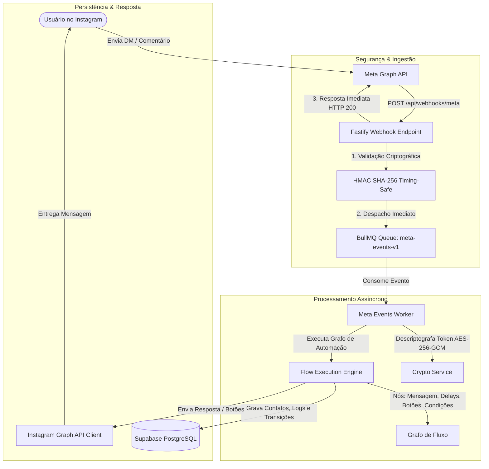

# 🚀 Camichat

> **Plataforma de Automação Inteligente para Instagram (Manychat Clone)**  
> Motor de alta performance construído com **Node.js, Fastify, TypeScript, Prisma, BullMQ, Redis e Meta Graph API**.

---

## 💡 Sobre o Projeto

O **Camichat** é um sistema completo de automação e engajamento para perfis profissionais do Instagram. Nascido para potencializar negócios locais e criadores de conteúdo (como a **Cami Unhas**), ele permite responder mensagens diretas (DMs), menções nos Stories e comentários de publicações em tempo recorde de forma 100% automatizada e personalizada.

O projeto foi arquitetado com padrões de engenharia de nível de produção:
- **Latência Ultra-Baixa**: Resposta ao Webhook da Meta em `< 10ms`.
- **Arquitetura Desacoplada**: Ingestão imediata de eventos em filas distribuídas (**BullMQ + Redis**).
- **Segurança de Nível Bancário**: Criptografia autenticada **AES-256-GCM** para tokens de acesso em repouso e validação **HMAC SHA-256** com proteção contra timing attacks.
- **Multi-Tenancy Nativo**: Isolamento completo de dados por Organização (`organization_id`).
- **Conformidade LGPD**: Gestão automática de Opt-in / Opt-out para respeito à privacidade do usuário.

---

## 🏗️ Arquitetura do Sistema



---

## ✨ Principais Funcionalidades

### 1. ⚡ Motor de Automação por Grafos (Flow Engine)
- **Gatilhos Múltiplos**:
  - `KEYWORD`: Palavras-chave configuráveis (ex.: `"preço"`, `"agendar"`, `"unhas"`).
  - `STORY_MENTION`: Resposta automática a quem marca o perfil nos Stories.
  - `STORY_REPLY`: Resposta a reações de Stories.
  - `COMMENT_REPLY`: Resposta imediata por DM a quem comenta em um post específico.
  - `POSTBACK`: Clique em botões interativos.
- **Tipos de Nós Suportados**:
  - `MESSAGE`: Envio de textos com suporte a variáveis do contato.
  - `QUICK_REPLY`: Botões de resposta rápida nativos do Instagram.
  - `DELAY`: Atrasos humanizados controlados de forma distribuída via BullMQ (`flowDelayQueue`).
  - `CONDITION`: Desvios lógicos baseados em tags, histórico ou campos personalizados do lead.

### 2. 🛡️ Segurança e Privacidade (LGPD)
- **Tokens Cifrados**: Page Access Tokens nunca são salvos em texto puro. Cada token possui seu próprio IV e Authentication Tag.
- **Descadastro Automático**: Se o contato enviar `"PARAR"`, `"CANCELAR"` ou `"SAIR"`, o sistema define `opt_out = true`, confirma o descadastro e bloqueia novas mensagens automatizadas.
- **Auditoria Completa**: Tabela `conversation_logs` registra timestamps, direção (`IN` / `OUT`), payloads originais e identificadores de mensagem (`mid`) da Meta.

### 3. 🏢 Isolamento Multi-Tenancy
- Todas as entidades (`contacts`, `instagram_accounts`, `flows`, `conversation_logs`) são vinculadas a uma `Organization`.
- Suporte a múltiplas contas conectadas sob o mesmo teto corporativo com total separação lógica.

---

## 🛠️ Stack Tecnológica

| Camada | Tecnologia | Descrição |
| :--- | :--- | :--- |
| **Runtime** | [Node.js](https://nodejs.org/) (v20+) | Plataforma de execução JavaScript/TypeScript |
| **Linguagem** | [TypeScript](https://www.typescriptlang.org/) | Modo estrito (`strict: true`, zero `any`) |
| **Framework HTTP** | [Fastify](https://fastify.dev/) | Servidor web ultra-rápido com suporte a raw body buffers |
| **ORM & Banco** | [Prisma](https://www.prisma.io/) + [PostgreSQL](https://supabase.com/) | Banco hospedado no **Supabase** com Connection Pooler |
| **Filas & Cache** | [BullMQ](https://bullmq.io/) + [Redis](https://upstash.com/) | Processamento assíncrono distribuído no **Upstash Redis** |
| **Validação** | [Zod](https://zod.dev/) | Tipagem e validação estrita de contratos e variáveis |
| **HTTP Client** | [Axios](https://axios-http.com/) | Integração robusta com a Graph API com timeouts e rate limiters |

---

## 🚀 Como Executar o Projeto

### 1. Clonar o Repositório
```bash
git clone https://github.com/thesouthamerica/Camichat.git
cd Camichat
```

### 2. Instalar Dependências
```bash
npm install
```

### 3. Configurar as Variáveis de Ambiente
Crie o arquivo `.env` baseado no modelo:
```bash
cp .env.example .env
```
Preencha com suas chaves:
- `DATABASE_URL` e `DIRECT_URL`: Conexão do **Supabase**.
- `REDIS_URL`: Conexão do **Upstash Redis** (`rediss://...`).
- `APP_ENCRYPTION_KEY`: Chave simétrica hex de 32 bytes (64 caracteres).
- `META_APP_ID`, `META_APP_SECRET`, `META_VERIFY_TOKEN`: Credenciais do **Meta for Developers**.

### 4. Executar as Migrações do Banco de Dados
```bash
npm run prisma:migrate
```

### 5. Iniciar o Servidor em Modo Desenvolvimento
```bash
npm run dev
```
*O servidor iniciará em `http://0.0.0.0:3000` pronto para receber conexões e processar as filas.*

### 6. Explorar o Banco de Dados Visualmente
```bash
npm run prisma:studio
```
*Abre uma interface web visual no navegador em `http://localhost:5555` conectada diretamente ao Supabase.*

---

## 🗺️ Roadmap do Projeto

- [x] Arquitetura base do Backend (Fastify + TypeScript)
- [x] Modelagem do banco relacional com Prisma
- [x] Integração e validação do PostgreSQL no Supabase
- [x] Configuração de Filas e Workers com BullMQ e Upstash Redis
- [x] Motor de execução de grafos de automação (Engine Workers)
- [ ] Conexão completa do Webhook ao vivo no portal Meta for Developers
- [ ] Criação de Dashboard Frontend (Interface visual estilo Manychat com construtor de nós e Inbox ao vivo)
- [ ] Integração com IA (LLMs) para respostas inteligentes em fallback

---

## 📄 Licença

Distribuído sob a licença MIT. Consulte `LICENSE` para mais informações.
